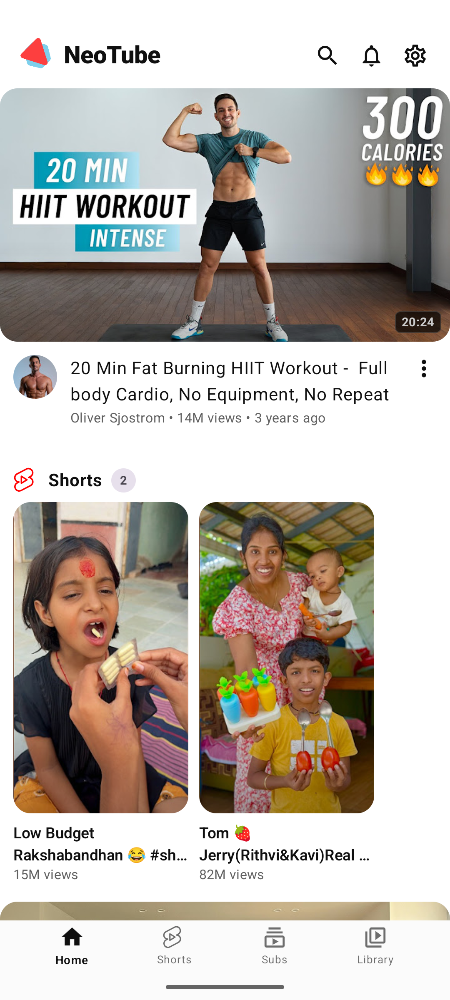
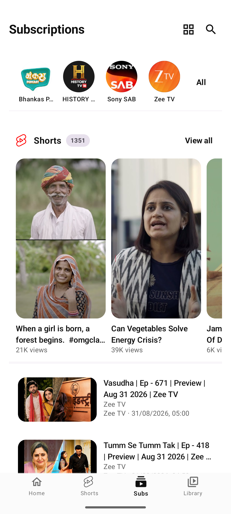
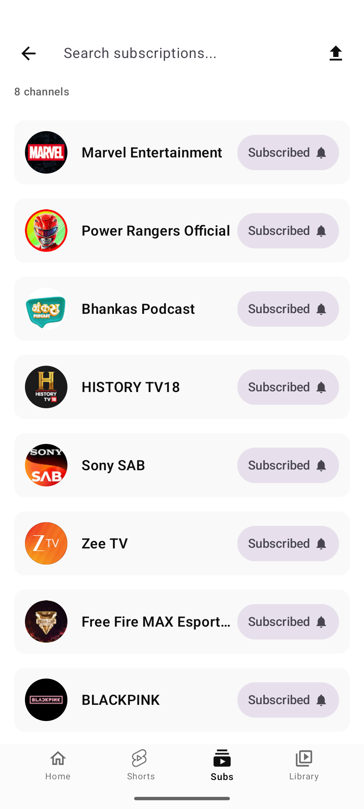

# NeoTube

<div align="center">
  

  <h1>NeoTube</h1>

  <p><strong>A modern, privacy-respecting, open-source Android video and music streaming client with an ad-free experience, background playback, offline downloads, and local intelligence.</strong></p>

  <p>
    <a href="https://github.com/samyak2403/NeoTube/releases"></a>
    <a href="LICENSE"></a>
    <a href="https://developer.android.com"></a>
    <a href="https://t.me/NeoTubeApp"></a>
  </p>

  <p>
    <a href="https://github.com/samyak2403/NeoTube/releases/latest">
      
    </a>
  </p>
</div>

---

## 🌟 Overview

**NeoTube** is built for users who value privacy, control, and performance. Powered by Jetpack Compose and ExoPlayer (Media3), NeoTube provides a distraction-free and ad-free viewing experience with no Google accounts, no tracking, and 100% on-device data storage.

NeoTube is fully **FOSS**-compliant, designed to build cleanly for **F-Droid** and **IzzyOnDroid** repositories with disabled dependency metadata and zero proprietary tracking SDKs.

---

## 📸 Screenshots

<p align="center">
  
  &nbsp;
  
  &nbsp;
  
  &nbsp;
  
  &nbsp;
  
</p>

---

## 🚀 Key Features

### 🎬 Video & Audio Playback
- **Ad-Free Streaming**: Enjoy videos without annoying interruptions.
- **Background & Lock Screen Playback**: Listen to audio or music seamlessly with the screen off or while multitasking.
- **Picture-in-Picture (PiP)**: Pop-out video player to keep watching while using other apps.
- **ExoPlayer (Media3) Engine**: Smooth streaming supporting 4K, 1080p, 720p, and adaptive bitrate switching.
- **Playback Controls**: Variable playback speeds (0.25x to 2.0x), chapter skipping, and seek jumping.
- **Intuitive Gestures**: Swipe controls for volume, brightness, and fast-seeking.
- **Subtitle Customization**: Customizable captions, size, and styling.

### ⚡ Community Integrations
- **SponsorBlock**: Automatically skip sponsored segments, intros, outros, subscription reminders, and filler.
- **Return YouTube Dislike (RYD)**: Displays accurate dislike counts and ratios on videos.
- **DeArrow Support**: Replace sensationalized thumbnails and clickbait titles with community-submitted alternatives.

### 📱 Shorts Experience
- **Dedicated Shorts Feed**: Smooth vertical scrolling for short-form content.
- **Auto-Scroll Mode**: Hands-free playback automatically scrolling to the next Short when the current one finishes.
- **Interactive Controls**: Like, share, view comments, and bookmark favorite Shorts.

### 🧠 On-Device Recommendation Engine
- **100% Private**: Recommendation model runs entirely on your device without sending watch telemetry to external servers.
- **Smart Adaptive Learning**: Learns preferences from watch time, likes, skips, and searches.
- **Topic Diversity Protection**: Prevents content fatigue and algorithmic echo chambers.

### 📂 Library & Offline Media
- **Local Watch History & Playlists**: Manage playlists and history stored securely in a local Room database.
- **Offline Downloads**: Download videos and audio for offline access.
- **NewPipe Import/Export**: Effortlessly import subscriptions and playlists from NewPipe or export your data at any time.

### 🛡️ Privacy & Freedom (FOSS)
- **No Google Account Required**: Full functionality without needing a Google account or microG.
- **No Telemetry**: No user tracking, analytics, or behavioral surveillance.
- **IzzyOnDroid / F-Droid Ready**: Clean FOSS build variant without proprietary updaters or build metadata tracking.

---

## 🛠️ Tech Stack

- **UI Framework**: [Jetpack Compose](https://developer.android.com/jetpack/compose) with Material Design 3
- **Language**: [Kotlin](https://kotlinlang.org/) (Coroutines, Flow, Serialization)
- **Architecture**: Clean Architecture + MVVM + Unidirectional Data Flow
- **Media Engine**: [AndroidX Media3](https://developer.android.com/guide/topics/media/media3) (ExoPlayer)
- **Dependency Injection**: [Hilt](https://dagger.dev/hilt/)
- **Database**: [Room](https://developer.android.com/training/data-storage/room) & [DataStore Preferences](https://developer.android.com/topic/libraries/architecture/datastore)
- **Networking**: [OkHttp](https://square.github.io/okhttp/) & [Ktor Client](https://ktor.io/)
- **Extractor**: [NewPipe Extractor](https://github.com/TeamNewPipe/NewPipeExtractor)

---

## 📦 Installation

### Pre-built APKs
Download the latest signed release APK directly from the [GitHub Releases](https://github.com/samyak2403/NeoTube/releases) page.

### Building From Source

1. **Clone the repository:**
   ```bash
   git clone https://github.com/samyak2403/NeoTube.git
   cd NeoTube
   ```

2. **Configure SDK Path:**
   Create a `local.properties` file in the root directory:
   ```properties
   sdk.dir=/path/to/your/android/sdk
   ```

3. **Build the FOSS Debug APK:**
   ```bash
   ./gradlew assembleFossDebug
   ```

4. **Build the FOSS Release APK:**
   ```bash
   ./gradlew assembleFossRelease
   ```
   The generated APK will be available in `app/build/outputs/apk/foss/release/`.

---

## 🤝 Community & Support

Have questions, suggestions, or found a bug? Join the community:

- **Telegram Channel**: [@NeoTubeApp](https://t.me/NeoTubeApp)
- **Issue Tracker**: [GitHub Issues](https://github.com/samyak2403/NeoTube/issues)
- **Contact Developer**: [samyakkamble2408@gmail.com](mailto:samyakkamble2408@gmail.com)
- **Instagram**: [@mr_samyakkamble](https://instagram.com/mr_samyakkamble)

---

## 💖 Support the Project

If you appreciate NeoTube and want to support ongoing development:

- **GitHub Sponsors**: [github.com/sponsors/samyak2403](https://github.com/sponsors/samyak2403)
- **UPI (India)**: `samyakkamble01430-4@oksbi`

---

## 📄 License & Attribution

- **NeoTube** is licensed under the [GNU General Public License v3.0 (GPLv3)](LICENSE).
- Powered by the incredible open-source [NewPipeExtractor](https://github.com/TeamNewPipe/NewPipeExtractor) project.
